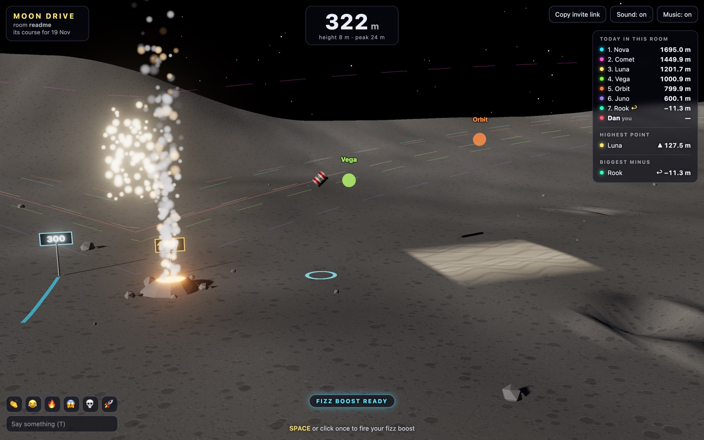
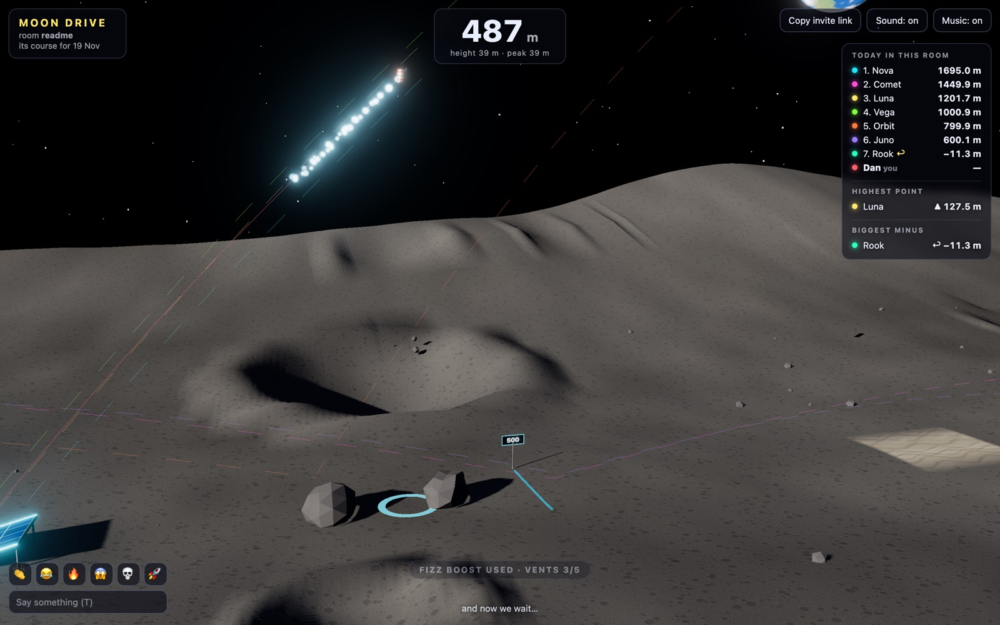
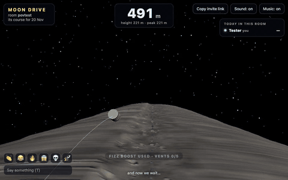
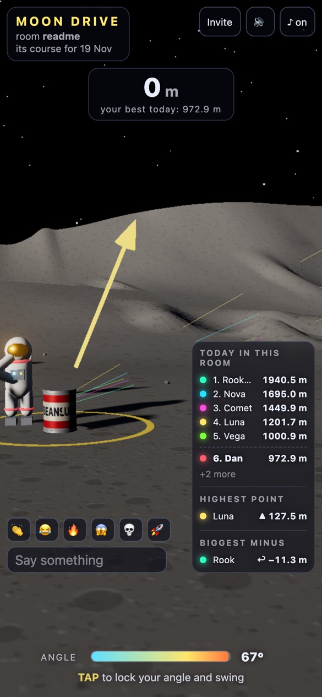
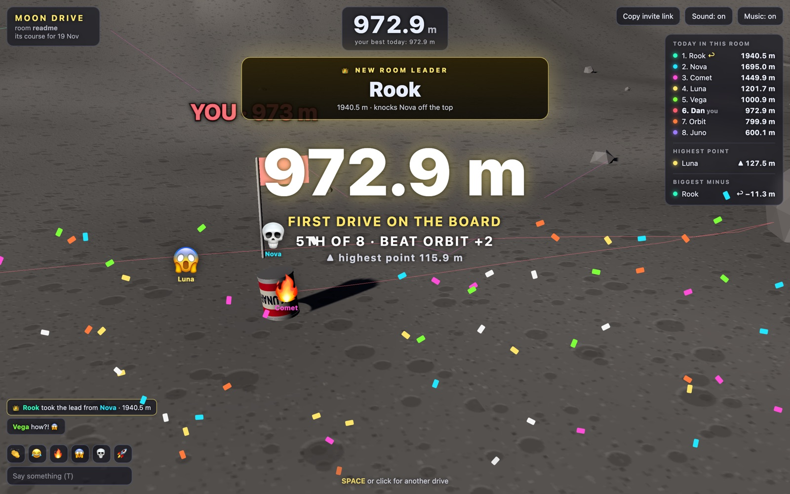

# Moon Drive

**A one-button multiplayer long-drive game on the Moon.** An astronaut tees off a tin can, and everyone on the
same link watches it fly, bounce off solar panels, ride gas vents and (with luck) roll for kilometres.
Each room gets a fresh course every day and a leaderboard that resets at midnight UTC.

**Play it: [moondrive.onrender.com](https://moondrive.onrender.com)** (free hosting, so the first visit after a
quiet spell can take half a minute to wake up)

## How to play

One button does everything: Space, a click or a tap.

1. **Power**: the meter sweeps; press to lock it.
2. **Angle**: the aim needle sweeps; press to launch.
3. **Fizz boost**: press once mid-drive to fire the can's boost. It pushes the way the can is travelling, so a
   boost on the way up adds height, one on the way down slams it into the ground, and one going backwards sends
   it further backwards.

Every five gas vents you ride in one drive earns another boost (5, 10, 15…), so a long chain of vents can keep
a drive going. Your score is where the can comes to rest.

## What's on the course

| Feature | What it does |
|---|---|
| **Solar ramps** | Springy panels that kick the can back into the sky without losing speed |
| **Gas vents** | Lift anything passing low overhead and push it on the way it's going |
| **Basalt slabs** | Slick rock the can slides along |
| **Dust drifts** | Soft ground that swallows a can's speed |
| **Craters and boulders** | Trouble, and sometimes a lucky bounce |

There's no finish line. The middle of the course is generous with ramps and vents; from about 3 km it gets
meaner every metre, so a great drive keeps going until the course wears it down. Drives can go backwards too:
a can that bounces back past the tee scores a negative distance, and the board keeps a record for the biggest
minus. What waits at the far end behind the tee is for you to find.

## Going high

Climb past 150 m and the camera leaves its side view for one just above and behind the can, so the drop back
down feels like falling.

## Playing together

- **Rooms**: everyone on the same link plays the same course and shares a board. Add `?room=anything` for a room of
  your own, and share it with "Copy invite link".
- **Live drives**: you see everyone else's cans in flight as they play.
- **The board** shows the top 20 (top 5 on phones) and your own place ("25th of 80"), plus height and minus records.
- **The feed** announces overtakes. A new leader gets confetti and a fanfare for the whole room.
- **Reactions and chat**: emoji that float up on everyone's screen, and a one-line chat.
- **Phones**: the same game in portrait, tap to play.

 

## How it works

- **One flight model, two machines.** The browser plays each drive, and the server replays it from just the
  inputs (power, angle and when each boost was pressed) to score it. The physics sticks to arithmetic that comes
  out bit-identical in every browser, so nobody can post a score their inputs didn't earn.
- **Seeded daily courses.** A course is built from the date and the room name, so everyone in a room gets the same
  layout, and every room's courses are checked months ahead before their day comes round.
- **Small and free.** A plain Node server with WebSockets and a three.js client, on free hosting, with the day's
  boards carried across deploys.

## Credits

Game by Dan Parry. Music: "Evening Discovery", made with [Suno](https://suno.com).

## Copyright

© 2026 Dan Parry. All rights reserved. The game's source code is private; this repository holds only its
description and screenshots, which may not be reused without permission.
